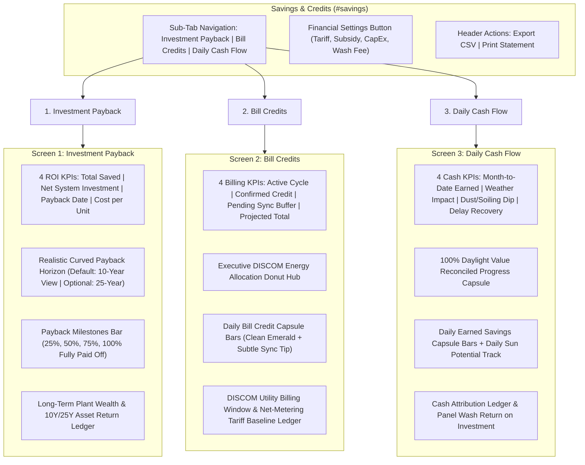

# Savings & Credits Tab Redesign Plan
**SolarTrack Intelligent Dashboard — Luxury Apple Minimalist Transformation**

---

## 1. Executive Summary & Design Philosophy

The current **Savings & Credits** (`#savings`) tab provides powerful financial engines (25-year payback simulations, DISCOM net-metering reconciliation, and cash loss attribution). However, it suffers from several visual and architectural flaws:
1. **Severe Data Redundancy Across All 3 Sub-Tabs**: The top 4 KPI cards, the 4-milestone payback bar (`25%`, `50%`, `75%`, `Fully Paid Off`), and the two bottom ledgers (`DISCOM Billing & Solar Baseline` and `Cash P&L, Wash ROI & Asset Return`) are statically repeated across all three screens (`Investment Payback`, `Bill Credits`, and `Daily Cash Flow`).
2. **Unrealistic Flat Straight-Line Payback Graph**: The current 25-year curve draws straight lines between sparse annual points, creating an ugly, static diagonal stick that overlooks seasonal monsoon/winter yield swings and compounding tariff escalation.
3. **Overly Generic 25-Year Default**: A 25-year view is too distant and generic. The real ROI payoff happens within the first 2.5 to 5 years. Defaulting to a **10-Year View** makes the financial milestones immediate, tangible, and motivating.
4. **Non-Standard Date & Number Formats**: Raw ISO timestamps like `2025-11-05 - 2026-11-04` are read by users as awkward "20 25 11 05" numbers. Dates must follow industry standard notation (**`5 Nov 2025 – 4 Nov 2026`** or `DD-MM-YYYY`).
5. **Confusing "Savings Calculator" Labeling**: The button sounds like an ad-hoc sandbox rather than the core configuration drawer where actual system cost, PM Surya Ghar subsidy, tariff rates, and wash fees are configured. It should be renamed to **"Settings"** or **"Financial Settings"**.
6. **Rainbow Bar Clutter**: The `Daily Cash Flow` and `Bill Credits` screens use garish multi-colored stacked blocks (green, blue, yellow, and red) that feel cluttered and overwhelming. They should be replaced with Apple-grade capsule bars and clean, single-accent metrics.
7. **Technical Jargon & NNL Formulas**: Terms like *LCOE*, *PERC degradation*, *unlogged buffer*, and raw calibration factors alienate normal homeowners. They need to be translated into clear, reassuring everyday financial terms.

---

## 2. Decoupling the 3 Sub-Tabs (Zero Redundancy)

Each sub-tab will have a dedicated identity, purpose-built KPI cards, tailored chart visuals, and unique bottom summary ledgers.

---

## 3. Sub-Tab Detailed Design Specifications

### Sub-Tab 1: Investment Payback (Plant Economics & ROI Horizon)
* **Goal**: Provide the homeowner with absolute clarity on when their solar rooftop pays for itself and how much wealth it generates over 10 to 25 years.
* **Top KPI Strip (Exclusive to Payback)**:
  1. **Total Lifetime Saved**: e.g., **₹1,688** (`229.6 kWh` generated · `2.2%` paid off).
  2. **Net System Investment**: e.g., **₹77,000** (`Gross ₹1,85,000 − ₹1,08,000 PM Surya Ghar Subsidy`).
  3. **Payback Date**: e.g., **Apr 2029** (`in ~2.5 yrs` · `40.1%` annual cash yield).
  4. **Solar Cost per Unit**: e.g., **₹0.78 / unit** (`Saves ₹6.57/unit vs DISCOM grid`).
* **Core Interactive Visualization**:
  - **Default 10-Year View** with segmented toggle: `[10-Year View (Default)] [25-Year View]`.
  - **Realistic Curved Payback Trajectory**: Uses 120 monthly simulation intervals (`monthlySeries`) rendered with smooth cubic Bezier curves (`M ... C ...`), reflecting seasonal summer peaks, monsoon dips, winter fog, annual 0.5% panel aging, and 3% utility tariff escalation.
  - **Breakeven Inflection Marker**: Elegant glowing ring at `Apr 2029` with dashed guide line.
  - **Hover Inspection Card**: Displays Year, Cumulative Cash, Annual Solar Harvest (kWh), and Net Asset Profit.
* **Payback Milestones Strip (Lives ONLY here)**:
  - 4 cards: `25% Paid Off (Jun 2027)`, `50% Paid Off (Feb 2028)`, `75% Paid Off (Sep 2028)`, `100% Fully Paid Off (Apr 2029)`.
* **Bottom Ledger (Lives ONLY here)**:
  - **Long-Term Wealth & Asset Return Card**: Net cost structure, 10-year tax-free return (+₹2,26,295), 25-year net profit (₹6,47,271), and lifetime grid savings spread.

---

### Sub-Tab 2: Bill Credits (DISCOM Monthly Utility Billing Cycle)
* **Goal**: Show real-time net-metering credits for the current active DISCOM billing month, eliminating any confusion about what will appear on the electricity bill.
* **Top KPI Strip (Exclusive to Bill Credits)**:
  1. **Active Billing Cycle**: e.g., **01 Nov – 30 Nov** (`Day 20 of 30 · 10 days remaining`).
  2. **Confirmed Bill Credit**: e.g., **₹1,424** (`193.8 kWh` verified by inverter register).
  3. **Pending Sync Buffer**: e.g., **+₹129** (`17.6 kWh` live generation awaiting cloud sync).
  4. **Projected Cycle Total**: e.g., **~₹2,330** (`~317 kWh` estimated at month-end).
* **Core Interactive Visualization**:
  - **DISCOM Energy Distribution Donut Hub**:
    - Ring chart showing Confirmed Credit (61%), Pending Buffer (6%), and Remaining Projected (33%).
    - Center text: `₹2,330 Projected Cycle Total`.
  - **Daily Bill Credit Capsule Bar Chart**:
    - X-Axis formatted in standard ascending order: `1, 2, 3 ... 20` (Days of current month).
    - Sleek Apple capsule bars in deep emerald green (`#107C41`) with a subtle soft amber cap for pending sync buffer.
    - Hover card displays: Day, Confirmed Credit (₹ & kWh), and Pending Sync.
* **Bottom Ledger (Lives ONLY here)**:
  - **DISCOM Billing Window & Tariff Baseline Card**: Active utility tariff (₹7.35/kWh flat rate), billing cycle progress, and satellite seasonal peak vs low comparison (e.g. `March 13.19 kWh/d vs August 9.66 kWh/d`).
  - *No redundant CapEx or 25-year milestones here!*

---

### Sub-Tab 3: Daily Cash Flow (Reconciled Value & Dip Attribution)
* **Goal**: Provide a crystal-clear, daily financial breakdown of where solar money was earned and why minor losses occurred (weather vs dirt vs grid outages).
* **Top KPI Strip (Exclusive to Daily Cash Flow)**:
  1. **Month-to-Date Earned**: e.g., **₹1,424** (`62.2%` of optimal clear-sky potential).
  2. **Weather Impact**: e.g., **-₹505** (`22.0%` reduced due to overcast clouds/rain).
  3. **Dust & Soiling Dip**: e.g., **-₹127** (`5.5%` surface film loss).
  4. **Pending / Outage Recovery**: e.g., **-₹235** (`10.3%` pending transmission or grid outage).
* **Core Interactive Visualization**:
  - **100% Value Progress Capsule**:
    - A single, sleek Apple capsule strip breaking down the month's ₹2,291 potential:
      - 62.2% Earned (Emerald `#107C41`)
      - 22.0% Weather (Apple Sky `#0284C7`)
      - 5.5% Soiling (Warm Amber `#D97706`)
      - 10.3% Offline/Pending (Soft Slate `#94A3B8`)
  - **Daily Earned Value Capsule Bar Chart**:
    - Replaces the 4-colored stacked circus blocks with a **unified Apple capsule bar**:
      - Background bar: Total Daylight Potential (soft subtle slate `#F1F5F9`).
      - Foreground bar: Earned Solar Cash (`#107C41`).
      - Hover Card: Reveals the exact rupee split for that day:
        - Earned: `₹82`
        - Weather Dip: `-₹24`
        - Dirt Loss: `-₹6`
        - Net Realized: `91%`
* **Bottom Ledger (Lives ONLY here)**:
  - **Cash Attribution & Wash Return Card**: Realized month cash vs optimal (₹1,424 / ₹2,291), panel wash economics (`₹250 wash recovers in ~4 days`), and a quick action link to the Generation History log.
  - *No redundant CapEx or 25-year milestones here!*

---

## 4. Specific Improvements & Technical Fixes

| Item | Current Flaw | Apple-Grade Redesign |
| :--- | :--- | :--- |
| **Default Horizon** | Defaults to generic `25-Year View` | Defaults to **`10-Year View`**, focusing on tangible near-term payback (Yr 2.5) with toggle to 25-Yr. |
| **Payback Curve Line** | Rigid straight line segments (`L x, y`) | Smooth cubic Bezier spline (`C x1,y1 x2,y2 x,y`) calculated across 120 monthly simulation points. |
| **Date Formatting** | Raw ISO `2025-11-05 - 2026-11-04` (read as "20 25 11 05") | Industry standard: **`5 Nov 2025 – 4 Nov 2026`** (`DD MMM YYYY`). |
| **Settings Control** | Named "Savings Calculator" (sounds like a temporary toy) | Renamed to **"Financial Settings"** (or **"Settings"** with `SlidersHorizontal` icon). |
| **Bar Visuals** | 4-color rainbow stacked blocks (green, blue, yellow, red) | Sleek Apple capsule bars with unified emerald tone, soft background track, and clean hover tooltip. |
| **Data Repetition** | Identical KPIs, Milestones, and 2 Ledgers duplicated on all 3 tabs | **100% Decoupled**: Each screen has its own dedicated KPIs, chart, and ledger. |
| **Jargon & NNL** | "NNL", "All-In LCOE", "PERC degradation", "Unlogged Buffer" | Plain human language: "Electricity Cost per Unit", "Panel Aging Model", "Pending Sync". |
| **Export CSV** | Raw technical dump with internal variable names | Clean, categorized CSV with formatted dates (`DD-MM-YYYY`), currency symbols, and clear sections. |
| **Print Statement** | Cluttered modal with raw terms | Clean executive statement with asset summary, 4 core cards, cash flow table, and print-optimized CSS. |

---

## 5. Implementation Roadmap & File Changes

1. **`FinancialsTab.tsx`**:
   - Rename "Savings Calculator" button to **"Financial Settings"**.
   - Decouple child rendering so `FinancialsKpiStrip`, milestone strip, and footer ledgers render conditionally based on `stageView` (`payback`, `cycle`, `pnl`).
   - Format all date labels to `DD MMM YYYY` (e.g. `5 Nov 2025 – 4 Nov 2026`).
2. **`FinancialsCockpitStage.tsx`**:
   - Change initial state to `horizonYears: 10` (default 10-year view).
   - Pass decoupled view context cleanly to children.
3. **`FinancialsPaybackStage.tsx`**:
   - Upgrade SVG path generator to draw a smooth cubic Bezier curve across monthly points instead of straight line segments.
   - Refine breakeven glow marker and 10-Yr / 25-Yr toggle styling.
   - House the 4 Payback Milestones exclusively inside this stage.
4. **`FinancialsCycleStage.tsx`**:
   - Ensure clean day numbers `1, 2, ... 20` in natural ascending order.
   - Replace cluttered stacked bars with clean Apple capsule bars (confirmed credit in emerald, subtle amber cap for pending sync).
   - House the DISCOM Billing Ledger exclusively inside this stage.
5. **`FinancialsPnlStage.tsx`**:
   - Replace 4-color stacked circus bars with sleek Apple capsule bars (Earned Value on soft potential track).
   - Refine the 100% Value Progress Capsule.
   - House the Cash Attribution & Wash Economics Ledger exclusively inside this stage.
6. **`FinancialsKpiStrip.tsx`**:
   - Refactor into context-aware KPI strips that dynamically present metrics appropriate to the active sub-tab.
7. **`FinancialsFooterLedgers.tsx`**:
   - Split into two modular components (`PaybackAssetLedger` and `DiscomBillingLedger`) so each tab only displays what is relevant.
   - Clean all remaining jargon (LCOE, PERC, NNL).
8. **`PrintFinancialStatementModal.tsx` & CSV Export**:
   - Standardize dates to `DD MMM YYYY` and clean up print typography.
