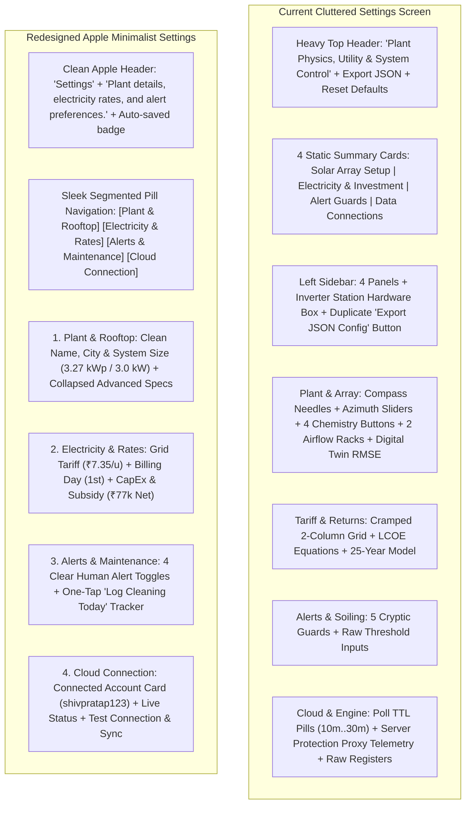

# Settings Tab Redesign Plan
**SolarTrack Intelligent Dashboard — Luxury Apple Minimalist Transformation**

---

## 1. Executive Summary & Design Vision

The current **Settings** (`#settings`) tab is cluttered with excessive engineering controls, redundant data summaries, and developer debugging telemetry. Instead of providing a calm, intuitive interface for configuring plant details and electricity rates, it presents over 35 distinct controls, rotating SVG compass needles, semiconductor chemistry boxes, backend proxy cache diagnostics, and duplicate `Export JSON` buttons.

### Key Flaws Identified:
1. **Redundant Top Cockpit Header & Static Summary Strip**:
   - The large `Plant Physics, Utility & System Control` header bar with `Export JSON` and `Reset Defaults` buttons covers excessive vertical space.
   - The 4-cell readiness strip (`Solar Array Setup`, `Electricity & Investment`, `Alert Guards & Panel Care`, `Data Connections`) statically repeats numbers already visible on Overview, System Health, and Financials.
2. **Duplicate "Export JSON" Buttons**:
   - An `Export JSON` button exists in the top cockpit header, and an identical `Export JSON Config` button is placed at the bottom of the left sidebar. Both clutter the UI and distract normal users.
3. **Severe Over-Engineering in Plant & Array**:
   - Contains a complex rotating SVG compass dial with -180° to +180° azimuth sliders, tilt angle sliders, "Match Latitude" buttons, 4 PV semiconductor chemistry options (Mono-PERC, TOPCon, HJT, Poly-Si), 2 pergola airflow options, digital twin calibration RMSE text, and 6 quick-city search chips (Lucknow, Mohali, etc.).
   - Normal rooftop owners never touch or understand these parameters once their system is installed.
4. **Cramped Side-by-Side Split Columns**:
   - Both `Plant & Array` and `Tariff & Returns` split settings into two cramped side-by-side columns that strain readability and feel cluttered.
5. **Developer & Proxy Telemetry in Cloud & Engine**:
   - Exposes internal backend proxy controls like "Open-Meteo Daytime Poll TTL" (10m, 12m, 15m, 20m, 30m pills) and "Live Server Protection Telemetry" (Token Caching, Flow Cache, Mobile Headers, Sequential Queue, Auto Backoff). These are debugging tools that should never be shown to an end user.
6. **Technical & SCADA Jargon**:
   - Uses terms like *LCOE*, *PERC degradation*, *k_site multiplier*, *SSE live*, and *digital twin RMSE* instead of friendly, everyday terms.

---

## 2. Structural Transformation: Before vs. After

---

## 3. Redesigned Screen & Header Architecture

### Clean Apple Header
- **Title**: `Settings`
- **Subtitle**: `Manage your rooftop solar plant, electricity tariff rates, alert notifications, and cloud sync.`
- **Status Indicator**: Subtle auto-saved badge: `● All settings saved`
- **Actions**:
  - Completely **remove** the redundant `Export JSON` buttons.
  - A subtle secondary "Reset to Defaults" option placed cleanly in the footer or menu, protected with a confirmation dialog.

### Unified Segmented Navigation
Replaces the cramped left sidebar + hardware box with an Apple-style segmented pill bar or clean minimalist sidebar:
1. **`Plant & Rooftop`** (`3.27 kWp · Kanpur`)
2. **`Electricity & Rates`** (`₹7.35/unit · Net ₹77k`)
3. **`Alerts & Maintenance`** (`4 Guards Active · Wash Tracker`)
4. **`Cloud Connection`** (`Waaree Cloud · Connected`)

---

## 4. Detailed Panel Redesign Specifications

### Panel 1: Plant & Rooftop (`plant`)
* **Core Philosophy**: Only show what a homeowner actually cares about. Hide complex physical equations inside an optional, collapsed disclosure.
* **Everyday Essential Controls (Clean Stacked Layout)**:
  1. **Plant Display Name**:
     - Label: `Plant Name`
     - Input: Clean text input (`shivpratap Singh`).
     - Subtitle: `Appears on your dashboard header and exported statements.`
  2. **Rooftop Location**:
     - Label: `Installation City & State`
     - Input: Search field pre-filled with `Kanpur, Uttar Pradesh` + `[Search City]` + `[My GPS]` button.
     - *Removed*: The 6 cluttery quick-city chips (Lucknow, Mohali, Delhi NCR, etc.).
  3. **System Capacity & Inverter Rating**:
     - Clean, read-only or editable summary:
       - **Solar Panel Array**: `3.27 kWp DC` (Rooftop capacity)
       - **Inverter Rating**: `3.00 kW AC` (Grid feed ceiling)
* **Collapsed "Advanced Physical Specifications" (Closed by Default)**:
  - An optional collapsible drawer: `▶ Advanced Array Physics & Geometry (Optional)`
  - Inside (clean numbers only, NO rotating compass needles):
    - Module Tilt Angle: `26.5°`
    - Array Facing Direction: `South (0°)`
    - Panel Technology: `Monocrystalline PERC`
    - Mounting Type: `Concrete Roof Mount`
  - Normal users never have to see or touch this!

---

### Panel 2: Electricity & Rates (`utility`)
* **Core Philosophy**: Simple, transparent inputs for the numbers that calculate your savings.
* **Clean Single-Column Cards**:
  1. **Grid Electricity Tariff**:
     - Label: `Electricity Tariff (₹ / unit)`
     - Input: `₹7.35` with quick preset buttons: `[₹6.50]` `[₹7.35]` `[₹8.00]` `[₹9.00]`.
     - Description: `Your utility rate from DISCOM, used to calculate daily and lifetime savings.`
  2. **DISCOM Billing Cycle Reset Day**:
     - Label: `Billing Cycle Reset Day`
     - Input: Number selector `1` (1st of every month).
     - Subtitle: `Active Billing Period: 1 Nov – 30 Nov (Day 20 of 30)`.
  3. **System Investment & Government Subsidy**:
     - Label: `Solar System Investment (CapEx)`
     - Gross Turnkey Cost: `₹1,85,000`
     - Government Subsidy: `₹1,08,000` (with 1-tap `[₹78,000 PM Surya Ghar]` button)
     - **Net Investment Summary**: Dynamically displays **`Net Investment: ₹77,000`** in bold emerald.
  4. **Panel Cleaning Fee**:
     - Label: `Panel Wash Cost (₹ / cleaning)`
     - Input: `₹250` per wash.
     - Description: `Used to calculate return on investment when cleaning dust off your panels.`
  5. *(Optional)* **Annual Tariff Inflation**:
     - Label: `Annual Rate Increase (% / year)`
     - Input: `3%` / year.

---

### Panel 3: Alerts & Maintenance (`alerts`)
* **Core Philosophy**: Reassuring protection switches with clear plain-English descriptions, plus an easy-to-use cleaning log.
* **4 Essential Alert Switches**:
  1. **Inverter Offline Alert**:
     - Label: `Inverter Offline Warning`
     - Switch: `[ ON ]` (Active)
     - Description: `Alerts you when the inverter stops sending data for more than 30 minutes during daylight.`
  2. **Morning Sunrise Wake-Up Check**:
     - Label: `Morning Start-Up Check`
     - Switch: `[ ON ]` (Active)
     - Description: `Verifies that your solar plant wakes up and connects to the grid each morning after sunrise.`
  3. **Power Cut & Grid Safety Watchdog**:
     - Label: `Power Cut & Grid Outage Alert`
     - Switch: `[ ON ]` (Active)
     - Description: `Detects when your inverter pauses due to a neighborhood electricity power cut.`
  4. **Low Production Warning**:
     - Label: `Underperformance Alert`
     - Switch: `[ OFF ]` (Muted)
     - Description: `Notifies you if solar generation drops significantly below clear-sky weather potential.`
* **Panel Cleaning & Maintenance Tracker**:
  - **Quick Action**: Prominent `[ + Log Cleaning Today ]` button.
  - **Dust Trigger**: `Recommend cleaning when dust reduces output by 7%` (with `5%`, `7%`, `10%` pills).
  - **Rain Auto-Reset**: `Reset dust tracking after 5 mm of rainfall`.
  - **Recent Washes History**: Clean, minimal list showing date (e.g. `28 Oct 2026`) and a delete/trash icon.

---

### Panel 4: Cloud Connection (`engine`)
* **Core Philosophy**: Show connection status clearly, allow syncing or testing, and remove all internal backend developer plumbing.
* **Connected Account Card**:
  - **Waaree Account**: `shivpratap123`
  - **Station Name**: `shivpratap Singh (3.00 kWp)`
  - **Connection Status**: `● Connected & Live` (SSE stream active)
  - **Actions**:
    - `[ Test Connection ]`: Runs a live ping check to verify credentials.
    - `[ Sync Now ]`: Fetches latest inverter register readings.
    - `[ Log Out & Disconnect ]`: Clean button in red/gray if switching accounts.
* **Pruned Clutter (Removed from UI)**:
  - ❌ *Removed*: "Open-Meteo Daytime Poll TTL" (10m, 12m, 15m, 20m, 30m pills).
  - ❌ *Removed*: "Live Server Protection Telemetry" (Token Caching, Flow Cache, Mobile Headers, Sequential Queue, Auto Backoff).
  - ❌ *Removed*: "Inverter Telemetry Channels" and "Inspect Raw Registers".
  - ❌ *Removed*: Duplicate "Export JSON Config" buttons.

---

## 5. Terminology Dictionary (Plain Human Language)

| Technical / SCADA Jargon | Plain Human Language (Redesign) | Why |
| :--- | :--- | :--- |
| `Plant Physics, Utility & System Control` | **Settings** | Normal users want clear, humble titles, not rocket science jargon. |
| `Mono-PERC / TOPCon / HJT` | **Monocrystalline PERC** | Clean standard description tucked into advanced specs. |
| `Flush on RCC Slab / Open Pergola` | **Concrete Roof Mount / Elevated Mount** | Clear physical description. |
| `Facing Azimuth (-180° to +180°)` | **Facing Direction: South (0°)** | Normal people don't think in raw azimuth degrees with rotating needles. |
| `Digital Twin Calibration Mode (K_site)` | **Rooftop Solar Model** | Normal users don't know what digital twins or empirical multipliers mean. |
| `Gross System Cost / CapEx` | **Total System Cost** | CapEx is corporate finance jargon. |
| `Open-Meteo Daytime Poll TTL` | *Removed completely* | Backend caching interval is internal plumbing. |
| `Server Protection Telemetry` | *Removed completely* | Developer debugging metrics should not be shown to homeowners. |
| `Export JSON Config` | *Removed completely* | Redundant and confusing for everyday users. |

---

## 6. Implementation Roadmap & Target Files

1. **`SettingsTab.tsx`**:
   - Remove the top cockpit header (`Plant Physics, Utility & System Control`) and the duplicate `Export JSON` buttons.
   - Remove `SettingsKpiStrip` (the 4 static summary cards).
   - Render the clean Apple header with Title, Subtitle, and auto-saved indicator.
   - Clean up navigation rail/segmented tabs.
2. **`PlantArrayPanel.tsx` / `PlantIdentityCard.tsx` / `ArrayGeometryCard.tsx` / `InverterTwinCard.tsx`**:
   - Merge into a streamlined, single-column **Plant & Rooftop** view.
   - Display: Plant Name, Location Search & GPS, Installed DC & AC capacities.
   - Remove rotating compass needle SVG, azimuth sliders, chemistry boxes, and digital twin RMSE text.
   - Place any needed physical specs into a clean, collapsible "Advanced Physical Specifications" drawer.
3. **`UtilityRoiPanel.tsx`**:
   - Convert cramped 2-column layout into clean single-column cards.
   - Clean up labels for Electricity Tariff, DISCOM Cycle Day, System Cost, and Subsidy.
4. **`AlertsSoilingPanel.tsx`**:
   - Clean up the 4 alert toggles with plain language descriptions.
   - Polish the panel wash log and one-tap "Log Cleaning Today" button.
5. **`AccountsEnginePanel.tsx`**:
   - Focus on the Connected Account card, Live Connection status, Test Connection, and Sync.
   - Remove backend TTL pills and server protection developer telemetry.
6. **Verification & Build**:
   - Run `npm run typecheck` and `npm run build` to ensure 0 compiler errors.
   - Verify on `http://localhost:3000/#settings`.
