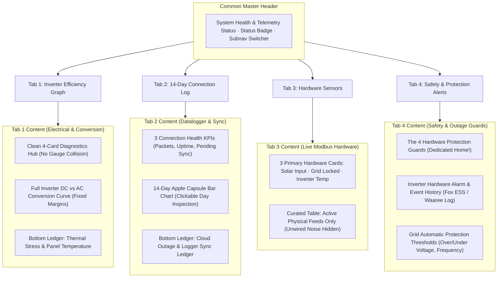

# System Health & Telemetry Tab Redesign Plan

## 1. Executive Summary & Design Vision

The **System Health** tab (`#health`) provides essential diagnostics for the solar installation: inverter conversion efficiency, datalogger reliability, live electrical measurements, and hardware protection guards. However, it currently suffers from severe usability and visual defects:

1. **Gauge Collision & Visual Breakage (Image 3)**:
   - In the Telemetry Hub inside the *Inverter Efficiency Graph* screen, circular MUI `<Gauge>` widgets have fixed dimensions that cause the numeric label (`84.8%` and `17%`) to collide directly with the gauge arc ring.
   - Furthermore, the exact same percentage is duplicated immediately next to the gauge in text, creating redundant, broken-looking cards.
   - Cards 3 and 4 have no gauges at all, resulting in jarring visual inconsistency across the 4 cards.
2. **Right-Edge Graph Text Clipping (Images 1 & 2)**:
   - In the Inverter Efficiency dual-axis chart, the right-hand Y-axis percentage labels (`100%`, `95%`, `90%`, `85%`, `80%`) and the top-right legend note are crammed against the container edge, with numbers getting cut off in half by `overflow-hidden`.
3. **Repeated Clutter Across All 4 Sub-Screens (Images 1, 4, 6, 7, 8)**:
   - Currently, switching between the 4 sub-tabs (*Inverter Efficiency Graph*, *14-Day Connection Log*, *Hardware Sensors*, *Safety & Outage Alerts*) keeps **over 70% of the screen completely identical and repeated**:
     - The top 4 KPI cards (`Inverter Efficiency`, `Panel Temperature`, `Connection Reliability`, `Morning Wake-up Time`) repeat on all 4 screens.
     - The 4-column System Guards strip (`Offline Delay Guard`, `Dawn Startup & Soiling Guard`, `Grid Safety / Anti-Islanding`, `Wash & Clear-Sky PR Guard`) repeats on all 4 screens.
     - The bottom 2 Ledgers (`Thermal Stress & MPPT Wake Audit`, `Cloud Outage & Logger Ledger`) repeat on all 4 screens.
   - Only a small middle rectangle changes, making the tab feel repetitive, overwhelming, and uncurated.
4. **Pill & Badge Overload**:
   - Excessive decorative pills (`Active MPPT`, `Unwired Port`, `Grid Locked`, `Efficiency 89.97%`, `Code 184`, `Fault Handled Safely`, `Triggered`, `Normal`, `Muted`) clutter nearly every row and header.
5. **Sensor Matrix Noise & Unwired Port Clutter (Images 6 & 7)**:
   - The *Hardware Sensors* view displays 11 sprawling rows where nearly half are unwired CT clamps, secondary unused strings, and unwired pyranometers (`0.00 kW All Day · External RS485 CT Clamp Not Wired`, `DC String 2 Unwired / Reserved Port`), accompanied by raw SCADA register names in parentheses like `(generationPower)`, `(pvPower)`, `(loadsPower)`.

### Target Vision: Apple Health & Device Diagnostics
This redesign transforms the System Health tab into a **focused, decoupled, luxury Apple diagnostic experience**:
- **Zero collisions**: Clean, proportional circular progress rings or unified linear capsules with perfect padding and consistent typography.
- **Zero text clipping**: Expanded chart margins with cleanly docked dual axes.
- **Purpose-driven sub-screens**: Each of the 4 sub-screens displays *only the metrics and modules relevant to that screen*, eliminating repeated data.
- **Pruned sensor matrix**: Only connected, live hardware feeds are highlighted; unwired ports are gracefully grouped or hidden.
- **Plain human vocabulary**: Replacing raw register keys and astrophysics abbreviations with clear solar hardware insights.

---

## 2. Core Problem Analysis & Architectural Solutions

| Current Implementation | Problem / Evidence | Apple Minimalist Redesign |
|---|---|---|
| **Circular Gauge Overlap (Image 3)** | Numeric value `84.8%` overlaps the red arc ring in `<Gauge>`, with duplicate text on the right; Cards 3 & 4 have no gauges. | **Unified Apple Diagnostic Cards**: Uniform layout across all 4 cards, either with sleek custom SVG progress rings (zero text collision) or clean linear fitness capsules. |
| **Graph Right-Edge Truncation (Images 1 & 2)** | Right Y-axis numbers (`100%`, `95%`, `90%`, `85%`, `80%`) and legend text hit the right margin and get cut off. | **Expanded Chart Margins**: Increase `padR` from `36px` to `58px`, adjust text anchors, and give axis ticks dedicated breathing room. |
| **70% Screen Duplication Across Tabs** | Top KPI strip, 4 Guard pills, and 2 bottom ledgers repeat statically across all 4 sub-screens. | **Decouple Screens**: Move Guard cards into *Safety & Outage Alerts*; move Logger ledger into *Connection Log*; move Thermal Stress into *Inverter Efficiency*; show screen-specific KPI summaries. |
| **Hardware Sensor Matrix Noise (Images 6 & 7)** | 11 rows of raw SCADA registers; half the table shows "Unwired CT Clamp", "Unused String 2". | **Curated Live Hardware Feed**: 3 primary Apple cards (Solar Array Input, Grid Power Quality, Inverter Thermals) + clean collapsible list of connected feeds only. |
| **Pill Clutter Everywhere** | Every single row and header is packed with competing multi-colored badge pills. | **Clean Hairline Typography**: Soft status dots (`emerald` / `amber` / `slate`) and quiet tabular figures without noisy colored borders. |

---

## 3. Sub-Screen Decoupling & Content Ownership

Instead of repeating the same guards, KPIs, and ledgers across all 4 views, each view will have a distinct, dedicated purpose:

---

## 4. Detailed Component-by-Component Specifications

### A. HealthTab.tsx (Master Container & Routing Shell)
1. **Remove Static Wrapper Repetition**:
   - Remove `
` from the bottom of `HealthTab.tsx`. Move guards into `HealthAlarmsView.tsx` where they naturally belong.
   - Remove static `<HealthFooterLedgers>` from `HealthTab.tsx`. Distribute the left card (*Thermal Stress*) to `HealthConversionCurveStage.tsx` and the right card (*Cloud Outage Ledger*) to `HealthSync14Stage.tsx`.
2. **Top Header Refinement**:
   - Clean, unified Apple status header:
     - Title: `System Health & Telemetry`
     - Status: `All Systems Normal` (Emerald) or `Attention Recommended` (Amber) with clean dot indicator.
     - Subtitle: `Real-time inverter diagnostics & communication integrity · Station 1e2b2018...`
   - Refined segmented subnav switcher:
     - `Inverter Efficiency`
     - `Connection Log (14d)`
     - `Hardware Sensors`
     - `Safety & Alerts`

---

### B. HealthConversionCurveStage.tsx (Inverter Efficiency Screen)
1. **Fix Gauge Collision (Image 3)**:
   - **Problem**: MUI `<Gauge>` with `width={74} height={64}` renders `text="84.8%"` directly intersecting the red arc, and the adjacent text duplicates `84.8%`.
   - **Fix**: Replace MUI `<Gauge>` with a custom, pixel-perfect Apple SVG ring or structured metric capsule:
     - Consistent geometry across **all 4 cards**:
       - **Card 1: MPPT Efficiency**: Clean progress ring (or capsule) + `84.8%` + `Euro-η Optimal / Normal Operation`. Zero overlap.
       - **Card 2: Capacity Attainment**: Matching progress ring + `0.52 kW` + `17% of 3.0 kW capacity`.
       - **Card 3: Heat Dissipation**: Matching format + `56 W` + `Inverter thermal loss (Normal)`.
       - **Card 4: Telemetry Quality**: Matching format + `14 Clean Samples` + `100% sample synchrony`.
2. **Fix Right-Edge Graph Text Clipping (Images 1 & 2)**:
   - Increase `padR` from `36px` (or `46px`) to **`58px`**.
   - Ensure the right-axis percentage tick text (`100%`, `95%`, `90%`, `85%`, `80%`) uses `textAnchor="start"` with a clean `4px` offset inside the expanded margin.
   - Adjust legend layout above chart: place `DC Array Input`, `AC Inverter Output`, `Heat Drop`, `Inverter η` in a clean, wrap-safe flex row with `gap-4`.
   - Keep the subtitle `Filtered: DC > 80W daytime operating range` without touching the right border.
3. **Dedicated Bottom Card**:
   - Embed the *Thermal Stress & Panel Temperature Audit* directly at the bottom of this screen.

---

### C. HealthSync14Stage.tsx (14-Day Connection Log Screen)
1. **Apple Capsule Bar Chart (Image 4)**:
   - Replace flat, sharp rectangular bars with sleek rounded capsule bars matching the Generation History aesthetic (`rx="full"` or `rx="6"`).
   - Soft background track (`#F1F5F9`) representing 100% packet potential.
   - Color hierarchy:
     - Emerald (`#10B981`): Complete sync (≥85% of packets).
     - Sky Blue (`#0284C7`): Partial cloud sync.
     - Amber (`#F59E0B`): Pending sync (<00:00 IST).
     - Rose (`#F43F5E`): Wi-Fi outage / dropped day.
2. **Top KPI Summary Strip**:
   - Display 3 clean datalogger metrics at the top:
     - **Connection Reliability**: `94%` (16/17 packets received today).
     - **Active Uptime**: `13 of 14 Days Synced`.
     - **Unlogged Days**: `1 Day` (Nov 10 Wi-Fi Outage).
3. **Dedicated Bottom Ledger**:
   - Embed the *Cloud Outage & Logger Sync Ledger* here.

---

### D. HealthChannelsView.tsx (Hardware Sensors Screen)
1. **Prune Unwired Sensor Spam (Images 6 & 7)**:
   - Remove or collapse unwired/dummy channels:
     - Remove `Home Consumption CT (loadsPower) [0.00 kW All Day · External RS485 CT Clamp Not Wired]` from main view.
     - Remove `Grid Export / Import CT [Mirrors Generation]` from main view.
     - Remove `Local Pyranometer [0.00 All Day · Local Sensor Unwired]` from main view.
     - Remove `DC String 2 (PV2 Secondary MPPT) [Unwired / Reserved Port]` from main view.
   - Add a quiet toggle at the bottom: `Show 4 Unwired / Optional Channels (CT Clamps & Secondary String)` for users who want to inspect unwired hardware ports.
2. **Clean 3-Card Hardware Hub**:
   - **Card 1: Solar Array DC Input (MPPT 1)**:
     - `275.2 V · 2.1 A` (`0.578 kW` input power).
     - Badge: `Active MPPT`.
   - **Card 2: Grid AC Power Quality**:
     - `254.5 V · 50.04 Hz` (`0.520 kW` delivered AC).
     - Badge: `Grid Synchronized`.
   - **Card 3: Inverter Thermals & Efficiency**:
     - `42°C` internal heatsink temperature.
     - `89.97%` conversion efficiency (`58 W` waste heat).
3. **Curated Active Feeds Table**:
   - Display only connected, verified channels with clean human labels:
     - `Inverter AC Output` (Live AC power delivered).
     - `Solar Array DC Input` (Direct DC generated from rooftop).
     - `Grid Voltage & Frequency` (DISCOM connection status).
     - `Inverter Heatsink Temperature` (Thermal dissipation).
   - Strip out raw SCADA strings like `(generationPower)` and `(pvPower)`.

---

### E. HealthAlarmsView.tsx (Safety & Outage Alerts Screen)
1. **Incorporate the 4 System Guards Here (Image 8)**:
   - Move the 4 System Guards from the global footer directly to the top of this screen:
     - `Offline Delay Guard (>30m)`: Normal (Heartbeat active).
     - `Dawn Startup & Soiling Guard`: Triggered (MPPT wake +37m due to morning haze).
     - `Grid Safety / Anti-Islanding`: Normal (254.5 V · 50.0 Hz locked).
     - `Wash & Clear-Sky PR Guard`: Triggered (-6.8% dust film · Wash recommended).
2. **Inverter Hardware Alarm Log**:
   - Keep the verified Waaree/Fox ESS alarm feed:
     - Green card when zero active alarms: `Zero Active Inverter Hardware Alarms` with clean shield icon.
     - Clean timeline when alarms or grid cuts occur.
3. **Inverter Automatic Protection Guard Thresholds**:
   - Clean 4-column card grid:
     - `Under-Voltage Trip (LV)`: `184.0 V (< 0.1s)`.
     - `Over-Voltage Trip (HV)`: `265.0 V (< 0.2s)`.
     - `Frequency Trip Range`: `47.5 Hz – 52.0 Hz`.
     - `Thermal Power Derating`: `65°C / Trip 85°C`.

---

## 5. File Modification Matrix

| File Path | Primary Responsibilities & Changes |
|-----------|------------------------------------|
| `apps/web/src/features/health/HealthTab.tsx` | Decouple sub-screens; remove static duplication of Guards and Ledgers from the root shell; refine header subnav. |
| `apps/web/src/features/health/HealthKpiStrip.tsx` | Remove tiny colliding half-gauges from KPI cards; ensure consistent text alignment and clean hierarchy. |
| `apps/web/src/features/health/HealthConversionCurveStage.tsx` | Redesign Diagnostics Hub to eliminate `84.8%` gauge text collision; expand right graph padding to prevent text clipping; embed Thermal Stress ledger. |
| `apps/web/src/features/health/HealthSync14Stage.tsx` | Upgrade 14-day bars to Apple capsule bars; embed top connection KPIs; embed Cloud Outage ledger. |
| `apps/web/src/features/health/HealthChannelsView.tsx` | Filter out unwired/dummy CT channels into collapsible group; display 3 clean Apple hardware cards; remove raw SCADA keys. |
| `apps/web/src/features/health/HealthAlarmsView.tsx` | Host the 4 System Guards at the top; present verified alarm feed and grid protection thresholds. |
| `apps/web/src/features/health/HealthFooterLedgers.tsx` | Refactor into modular exportable components (`ThermalStressLedger` and `CloudOutageLedger`) used by their respective views. |

---

## 6. Implementation & Execution Plan

### Phase 1: Modularize Ledgers & Guards
- Refactor `HealthFooterLedgers.tsx` to export independent, self-contained sections:
  - `ThermalStressLedgerCard` (for Inverter Efficiency screen)
  - `CloudOutageLedgerCard` (for Connection Log screen)
- Refactor System Guards so they render natively within `HealthAlarmsView.tsx`.

### Phase 2: Fix Gauge Collision & Graph Margins in HealthConversionCurveStage.tsx
- Replace the broken MUI `<Gauge>` widgets in the 4-card hub with uniform, beautiful Apple diagnostic cards (zero text collision, consistent typography across all 4 cards).
- Increase right padding (`padR: 58`) and format right Y-axis tick anchors so percentage labels (`100%` - `80%`) are never cut off.

### Phase 3: Prune Unwired Hardware Channels in HealthChannelsView.tsx
- Create a clean 3-card live hardware matrix (Solar Input, Grid Locked, Inverter Temp).
- Filter out unwired ports (String 2, RS485 CT clamp unwired, Pyranometer unwired) into a neat collapsible section.
- Remove raw API key names like `(generationPower)`.

### Phase 4: Upgrade 14-Day Connection Log in HealthSync14Stage.tsx
- Implement Apple capsule bars with soft benchmark tracks.
- Integrate connection reliability KPIs and embed the Cloud Outage ledger.

### Phase 5: Decouple HealthTab.tsx & Verification
- Clean up `HealthTab.tsx` so only the view-specific content renders on each tab.
- Run `npm run typecheck` across web and core packages.
- Run `npm run build` to verify clean compilation.
- Test in browser to confirm zero white screens, zero text clipping, zero gauge collisions, and zero duplicate screens.
